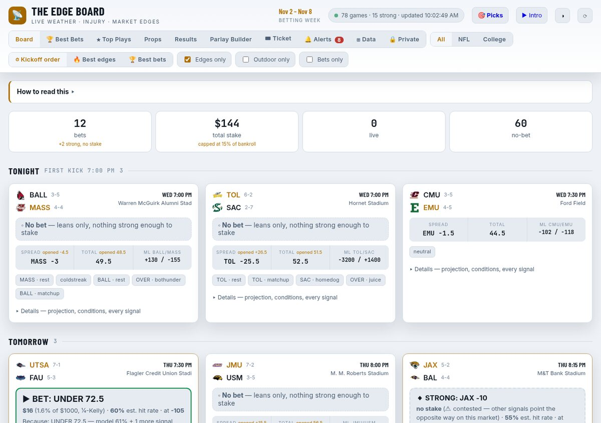
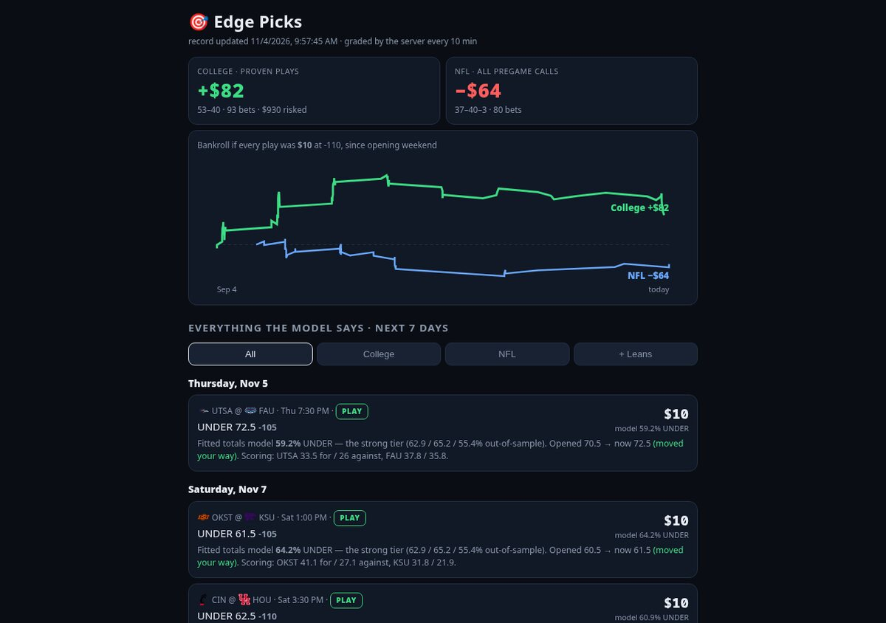
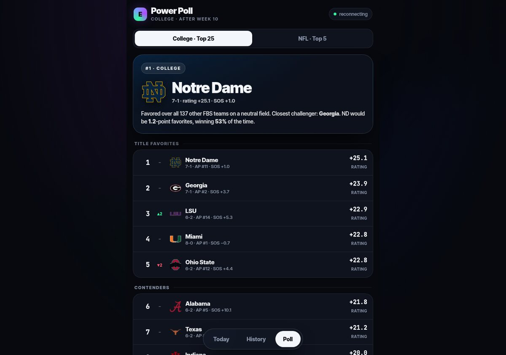

# The Edge Board

[](https://nfl-edge-kappa.vercel.app)
[](LICENSE)
[](https://vercel.com)
[](https://nfl-edge-kappa.vercel.app)
[-lightgrey)](#run-locally)

Live NFL + college football betting-edge board. Pulls weather, injuries, odds, line
movement and in-game scores from ESPN's public feeds, runs them through a set of
measured signals, and shows where the line looks wrong — with an honest record of how
those calls actually did.

**Live:** https://nfl-edge-kappa.vercel.app (installable as a phone app)



<table>
<tr>
<td width="50%"><a href="https://nfl-edge-kappa.vercel.app/picks"></a></td>
<td width="50%"><a href="https://nfl-edge-kappa.vercel.app/power"></a></td>
</tr>
<tr>
<td align="center"><b>Picks</b>: server-graded record and the next 7 days of plays</td>
<td align="center"><b>Power Poll</b>: least-squares ratings, ordering = head-to-head order</td>
</tr>
</table>

## What it does

- **Rolling Mon→Sun week** across NFL and FBS college football, auto-refreshing.
- **~30 signals** — wind/precip/cold on totals, QB out (role-weighted by that team's
  actual passing leader), steam/line movement, juice leans, opponent-adjusted power
  ratings vs the market, ranked huge-dog spots, ranked-vs-ranked unders, rest/short
  prep, coaching, altitude, dome fades, live in-play pace vs the **live** line, more.
- **Weighted stacking** — signals agreeing on a side are scored by evidence weight,
  not counted; conflicts between signals are surfaced, never hidden.
- **Projected lines** — our own Massey-style power ratings blended with ESPN's
  matchup model, with injury adjustments; edge vs the market shown per game.
- **Stake sizing** — each strong play gets an estimated hit probability from the
  best evidence available and a quarter-Kelly stake against your bankroll.
- **🏆 Best Bets** — its own view: the plays that clear the bar, split NFL / college,
  each one showing the number behind it, the sample that number came from, the market
  price and which book set it. It says **"nothing worth betting"** when nothing qualifies
  rather than ranking the least-bad options. Plus the Best bets sort, ★ Top Plays,
  Props (directional), Parlay Builder.
- **Track Record** — every strong call is logged the moment it appears with the line
  frozen, graded when the game goes final, with closing-line value, a per-signal
  self-audit, fade detection, and live covering/trailing status for open calls.

## Backtests (2023–2025, real closing lines, 3,371 games)

Every rule is judged on three full seasons and must beat break-even (52.4%) in **each**
season. Only three-for-three signals can make a strong call on their own.

| Signal | NFL | College | Status |
|---|---|---|---|
| Our ratings vs closer, 3+ pt gap, week 10+ | **56.5%** (54 / 59 / 57) | 50.4% | NFL strong; CFB held at lean |
| Total 60+ → UNDER | — | **56.1%** (55 / 61 / 53) | strong |
| Dog implied ≤10 pts → OVER | — | **56.0%** (54 / 56 / 58) | strong |
| Both teams' last game went UNDER → OVER | **58.4%** (55 / 59 / 63) | 53.6% | not live yet |
| Favorites of 10+ | 56.2% (52 / 58 / 58) | — | lean (thin) |
| Ranked vs ranked → UNDER | — | 56.7% (51 / 56 / 62) | lean |
| Unranked laying 21+ vs FCS → favorite | — | 53.1% (**43** / 58 / 59) | lean |
| Dog +7 to +9.5 | 57.5% (49 / 66 / 58) | — | lean |
| Ranked laying 28+ vs FBS → dog | — | 53.0% (51 / 43 / 62) | lean |
| Primetime dog, 4pm over, held-to-≤7, rested-team fade, total ≤45 under | one-season wonders | | removed |
| Home dogs, always-over, divisional under, revenge, rest | coin flips | coin flips | not signals |

A second wall used true opening/closing lines (line-movement rules: nothing except a move against a ranked team, 58/58/53%) and full box scores (yards per play, turnovers, third downs: nothing — the market prices efficiency; turnover-luck "regression" is a stable loser at 44%). Closing-line-value per spot drives a bet-timing note on every call.

117 rule×league tests were run ("the wall"); every result, including the failures, is
shown in the app's Results → Advanced section. Weather was backtested on real kickoff conditions (Open-Meteo archive, 3,040 outdoor
games): NFL 20+ mph gusts → UNDER 57.9% but 71/43/61% by season; college wind 50%;
rain over in college, cold over in the NFL. Weather is lean-only with measured weights.

A fitted 21-feature logistic **totals** model (leave-one-season-out: college ≥58% confidence
62.9/65.2/55.4%, NFL 55/56.5/52.4%) is the best-validated call on the board; side models
failed and are not shipped.

## Architecture

No framework and no build step: static HTML/JS pages, a handful of Vercel Node
functions, one Vercel Blob store for shared state, and a scheduler. The interesting
decision is that **the server runs the front-end's own engine**, so the graded record
can never disagree with what a viewer saw on their phone.

```
 ESPN public feeds                     Vercel functions (api/)                   Clients
 ─────────────────                     ───────────────────────                   ───────
 site.api.espn.com   ─┐
   scoreboard/summary │   _espn.js  allow-listed fetcher, ~10s cache,     ┌─► board.html (full board)
 sports.core.api      ├─► espn.js / bulk.js  (proxy, CDN-cached) ─────────┤   index.html (Today/History/TDs)
   odds, closers      │                                                   │   picks.html, power.html
 pickcenter, injuries ┘   _engine.js  runs board.html's script in a       │
                          Node vm with a stubbed DOM                      │
                              │  signals → stacking → calls → grading     │
                              ▼                                           │
                          cron/grade.js ──► Blob: edge/record.json ──► record.js
                              │                                           │
                              └─► _push.js ── Web Push (VAPID) ──► sw.js  │
                          _scan.js  ──► upcoming.js  (7-day model read)   │
                          _power.js ──► power.js     (Power Poll)    ─────┘
                          _tdbuild.js ► td.js        (anytime-TD board)
```

### Data flow: feeds → signals → stacking → picks → grading

1. **Ingest.** Every ESPN request goes through `api/_espn.js` (see below for why).
   It allow-lists hosts, clamps `limit` to ESPN's real ceiling of 500, rebuilds dead
   `dates=A-B` ranges day by day, and reports upstream failures as failures, never as
   an empty slate. `api/bulk.js` batches a whole slate's summary calls into one round trip.
2. **Signals.** The board engine (in `board.html`) turns scoreboard, summary, odds,
   injuries, weather and live scores/lines into ~30 boolean/graded signals per game,
   each carrying a weight measured in the backtests above.
3. **Projections.** `api/_power.js` solves a regularised weighted least-squares system,
   `(AᵀWA + Λ)x = AᵀWb + Λμ` (plain Gaussian elimination, ~300 unknowns), over closing
   spreads (weight 2) and capped final margins (weight 1), with recency half-lives, a
   light FBS/FCS prior and a fitted home-field term, to get one neutral-field rating per team. That is blended with
   ESPN's matchup predictor and injury adjustments into a projected line. A fitted
   21-feature logistic totals model (`api/_logit.json`) scores every total.
4. **Stacking and verdicts.** Signals that agree on a side are summed by evidence
   weight, and conflicts are surfaced rather than cancelled. `verdict.js` is **the one
   rule set** deciding PLAY / LEAN / none and confidence, and the same file is loaded by
   the browser and by the server (`api/_applog.js`), so the history tab is literally
   "what this app would have played". Strong plays get a hit probability and a
   quarter-Kelly stake.
5. **Freeze and grade.** A call is logged the moment it first appears, with the line
   frozen. `api/cron/grade.js` loads the shared record from Blob, runs the engine
   against live data (`api/_engine.js`), grades finals against the *called* number,
   computes closing-line value, and writes `edge/record.json` back. Every device reads
   that one document via `GET /api/record`.

### Scheduling

- **GitHub Actions** (`.github/workflows/grade.yml`) pings `/api/cron/grade` every
  10 minutes with a shared key, then warms `/api/td` and `/api/power`.
- **`/api/tick`** is a public, rate-limited backstop: any open board calls it, and if
  the shared record is more than 8 minutes old it runs the same grader in-process.
  It needs no key because it can only ever do the scheduled job.
- Derived documents (`upcoming`, `power`, `applog`, `td`) are rebuilt at most every
  20 to 30 minutes and cached in Blob plus the CDN (`s-maxage` + `stale-while-revalidate`).

### Web Push

`api/subscribe.js` hands the browser the VAPID public key and stores
`PushSubscription`s. After each grading run `api/_push.js` sends only the alerts newer
than the last push (new call, line move, live bet, fade, result) and collapses bursts
of more than four into one summary. Dead endpoints (404/410) are pruned. The Blob store
is public-read, so subscriptions live at a path derived from a secret: the unguessable
path is what keeps those capability URLs private. `sw.js` shows the notification and
deep-links to `/#alerts`.

### Offline and caching (`sw.js`)

The app shell (HTML, icons, `verdict.js`, manifest) is stale-while-revalidate so the
installed PWA opens instantly. **Live data is network-only and never cached**: a
stale odds line or old weather reading is worse than nothing for a tool like this.
`/api/*` bypasses the worker entirely.

### Files

```
board.html          the full board: state, signals, projections, stacking, all views
index.html          mobile Today / History / TDs view over the server documents
picks.html          server-graded record + every play for the next 7 days
power.html          Edge Power Poll (college Top 25, NFL)
intro.html          45s animated intro, Web Audio synthesized music
verdict.js          the single PLAY/LEAN rule set, shared by browser and server
sw.js               PWA service worker: shell stale-while-revalidate, live data network-only
api/_espn.js        server-side ESPN fetcher: allow-listed hosts, ~10s memory cache,
                    limit clamped to ESPN's real max of 500, and dead `dates=A-B`
                    scoreboard ranges rebuilt day-by-day
api/espn.js         GET  /api/espn?u=<espn url>     single proxied call, CDN-cached
api/bulk.js         POST /api/bulk {urls:[...]}     one round-trip per batch of games
api/_engine.js      runs board.html's engine in a Node vm (stubbed DOM, seeded localStorage)
api/cron/grade.js   GET  /api/cron/grade?key=…     scheduled grader + push fan-out
api/tick.js         GET  /api/tick                 public backstop for the scheduler
api/record.js       GET  /api/record               the shared graded record
api/_scan.js        7-day slate scanner (totals model + surviving rule signals)
api/upcoming.js     GET  /api/upcoming
api/_power.js       weighted least-squares power ratings
api/power.js        GET  /api/power
api/_applog.js      2026 season replayed through verdict.js, graded vs the closer
api/applog.js       GET  /api/applog
api/_td.js, _tdbuild.js, td.js   anytime-TD model, play log and backtest
api/_push.js        Web Push (VAPID) fan-out
api/subscribe.js    GET/POST /api/subscribe        VAPID key, (un)subscribe, test push
api/_store.js       tiny JSON-document layer over Vercel Blob
api/_logit.json     fitted totals-model coefficients
scripts/selftest.js dev: runs the page in a Node vm against live ESPN and asserts
scripts/dev-server.js  dev: static files + the real /api/espn and /api/bulk handlers
reports/            offline analysis scripts and write-ups
manifest.webmanifest, icon-*.png
```

### Why all ESPN traffic goes through `/api`

ESPN's Akamai edge answers browser-shaped
cross-origin requests (real user-agent + `Origin` + `Sec-Fetch-*`) with **403 and no
`Access-Control-Allow-Origin`**, so the old client-side "fall back to calling ESPN
directly" path fails CORS every time and a purely static copy no longer loads data.
Every repair for a changed upstream shape belongs in `api/_espn.js`, and a failure
there is reported — never turned into an empty list.

Data sources: `site.api.espn.com` scoreboard + summary (odds, weather, injuries,
predictor, last-five, pickcenter), `sports.core.api.espn.com` odds (keeps the
pregame closer and the live line after kickoff; retains closing odds for completed
games, which is what makes the backtests possible).

## Run locally

Requires Node 18+ (for global `fetch`). There is nothing to compile.

```
git clone https://github.com/JROtto5/nfl-edge && cd nfl-edge
npm install
node scripts/dev-server.js        # http://localhost:4399/board
```

The dev server serves the static pages and the real ESPN proxy handlers, which is
enough for the full board (`/board`) to load live data. The server-backed views
(record, picks, power poll, push) need the Blob store and the rest of `api/`, so run
them under the Vercel CLI against your own project:

```
vercel link
vercel env pull .env.local        # or create it yourself with the names below
vercel dev
```

Environment variables (names only; set the values in your Vercel project):

| Variable | Used by | Purpose |
|---|---|---|
| `BLOB_READ_WRITE_TOKEN` | `api/_store.js` (via `@vercel/blob`) | read/write the shared JSON documents |
| `CRON_KEY` | `api/cron/grade.js`, `api/tick.js`, GitHub Actions secret | authorises the scheduled grader |
| `VAPID_PUBLIC`, `VAPID_PRIVATE` | `api/_push.js`, `api/subscribe.js` | Web Push key pair (`npx web-push generate-vapid-keys`) |
| `VAPID_SUBJECT` | `api/_push.js` | contact `mailto:` for push services |
| `PUSH_SECRET` | `api/_push.js` | unguessable path segment for the subscription document |

Push is optional: without the VAPID variables `/api/subscribe` answers 503 and
everything else keeps working.

## Testing

There is no build step. Signals are tested by running the page's script in a Node
`vm` sandbox against captured ESPN JSON (real slates, real live-odds payloads) plus
synthetic known-answer scenarios, and the API handlers are called directly in Node.
No debug hooks are ever shipped — `grep -c __DBG index.html` must be `0` before deploy.

```
node scripts/selftest.js          # runs the page in a vm against live ESPN, asserts
node scripts/dev-server.js        # http://localhost:4399 with the real /api handlers
FAIL=cfb node scripts/dev-server.js   # inject a league feed outage to check it's visible
```

`selftest.js` covers the failures that have actually happened: the dead date-range
query, ESPN's silent 500-event `limit` ceiling, both leagues reaching the board, a
fabricated empty feed being reported instead of shown as "no games", and Best Bets
being willing to say nothing.

## Deploy

```
vercel --prod
```

## Honesty rules

- A "strong" label has to be earned by weighted evidence, not by counting leans.
- Calls are graded against the number that was actually called, never a later one.
- Negative backtest results are shown, and they lower the signal's weight.
- Nothing here places a bet or promises anything. Reference math only.

## Responsible use

This is a sports-analytics and entertainment project. It does not place bets, it is
not financial or gambling advice, and past results (including the backtests above) do
not guarantee future ones. Check the laws where you live, only risk what you can afford
to lose, and if gambling stops being fun, help is available at 1-800-GAMBLER
(US) or [ncpgambling.org](https://www.ncpgambling.org).

## License

[MIT](LICENSE) © 2026 JROtto5
